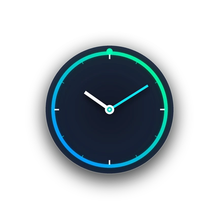

# ColorOS AOD Helper

  

  <b>ColorOS 全景息屏全天常亮增强与双击防误唤醒纯净 LSPosed 模块</b>

  
  
  
  

---

## 📖 项目简介 (Introduction)

**ColorOS AOD Helper** 是一款专为 OPPO / 一加 (OnePlus) / 真我 (Realme) 系列机型打造的息屏增强 Xposed 模块。

针对系统对“全景息屏”（壁纸息屏）在常亮时长及息屏手势上的限制，本模块重构了息屏调度链路，在保证系统绝对稳定、零额外功耗的前提下，实现全天常亮与精准的手势跟随体验。

### 📱 兼容性与真机实测说明 (Compatibility)

* **真机实测通过设备**：
  * **OPPO Find X9 Ultra**（ColorOS 17）
  * **OPPO Pad mini**（ColorOS 17）
* **关于 ColorOS 15 与 16**：
  * 作者仅在上述运行 ColorOS 17 的设备上进行了完整测试与验证；
  * 从底层接口与方法签名来看，息屏显示（`com.oplus.aod`）和系统界面（`com.android.systemui`）的核心逻辑具有高度延续性，**理论上支持 ColorOS 15 与 ColorOS 16**，持有相关设备的用户可自行测试。

### 🌟 极致轻量与纯净架构 (Ultra-Lightweight & Clean)

* ⚡ **体积骤降 93%**：由原版臃肿框架的 2.8 MB 极限精简至 **197 KB**。
* 💎 **DEX 代码仅 4.8 KB**：彻底剔除冗余的第三方框架（YukiHookAPI）、Kotlin 运行库、AndroidX 界面库及多余类，仅保留 3 个纯原生 Xposed 钩子类。
* ❌ **零后台常驻**：无前台界面、无桌面图标、无常驻 Service、无任何网络权限索取，系统息屏服务按需加载，性能损耗趋近于零。

---

## ✨ 核心功能 (Features)

### 1. 全景息屏解锁“全天常亮”显示 (Panoramic AOD Always-On)
* **系统痛点**：官方在全景息屏（壁纸息屏）下仅允许“智能显示”或“定时显示”，无法自由选择“全天常亮”。
* **本模块实现**：彻底打通底层策略与设置逻辑，支持全景息屏自由开启“全天常亮”，享受如智能手表般的永恒流光视觉。

### 2. 息屏手势完美对齐，根治“锁屏前一秒误唤醒” (Fix 1s Accidental Wakeup)
* **系统痛点**：关闭“双击亮屏与息屏”后，锁屏过渡缓冲期（灭屏前一秒）由于手势与传感器信号紊乱，极易发生屏幕刚灭又被误唤醒点亮的问题。
* **本模块实现**：精准拦截灭屏缓冲期的伪唤醒广播，彻底修复锁屏前一秒误唤醒 Bug；无论是否开启双击亮屏，息屏与亮屏均干净利落。

---

## 🛠️ 安装与使用指南 (Usage Guide)

1. **环境要求**：
   * 设备已解锁 Bootloader 并获取 Root 权限（Magisk / KernelSU / APatch）；
   * 已安装并激活 **LSPosed** 框架（推荐使用最新版 LSPosed）。
2. **安装步骤**：
   * 前往 [Releases](https://github.com/GloamingCity/ColorOS-AOD-Helper/releases) 下载最新的 `ColorOS_AOD_Helper_v1.0.apk` 并安装；
   * 打开 LSPosed 管理器，在模块列表中启用 **ColorOS AOD Helper**；
   * 勾选推荐作用域：
     * `com.android.systemui`（系统界面）
     * `com.oplus.aod`（息屏）
   * 强行停止或重启“系统界面”与“息屏”，或直接重启手机即可生效。

---

## 🤝 致谢与声明 (Credits & Acknowledgments)

* **模块修改工作声明**：
  > **本项目所有的反编译逆向分析、代码逻辑重构、去框架轻量化改写及 Bug 修复工作，完全由 Gemini 3.8 flash 独立完成。**

* **向原作者致敬与致谢**：
  * 向 **ColorOS AOD增强** 原作者致谢，感谢其探索出的全景息屏常亮判定 Hook 思路；
  * 向 **别他妈亮了**（nep.timeline）原作者致谢，感谢其在手势拦截与双击判定方面的实践启示。

本项目在两位原作者优秀思路的基础上，完成了代码纯原生化重构与跨版本架构对齐，解决了旧版本的逻辑冲突与闪退缺陷。

---

## 📄 开源许可证 (License)

本项目采用 [GNU General Public License v3.0 (GPL-3.0)](LICENSE) 开源许可证。
